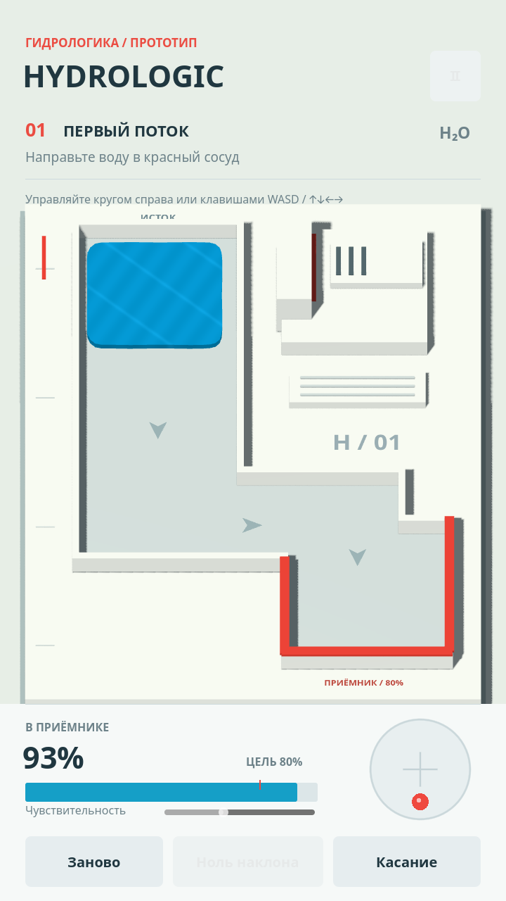

# Гидрологика / Hydrologic

Android-игра о перемещении жидкости наклоном телефона. **Версия 0.1.0: один игровой уровень «Первый поток».** Для прохождения нужно провести воду по широкому каналу с двумя поворотами и удержать в красном приёмнике не менее **80%** исходного объёма в течение **0,75 с**.



## Попробовать на Android

Тестовая сборка — `build/hydrologic-0.1.0-android.apk` (предоставляется с результатом разработки; в Git бинарник не хранится). Workflow в [Actions](https://github.com/zakgovin/LiquidGame/actions) также собирает APK и сохраняет артефакт `hydrologic-android-debug`, если запуск разрешён настройками репозитория. Это сборка с debug-подписью, не публикация в Google Play. Минимум Android 7.0 (API 24), OpenGL ES 3.0; архитектуры ARM64 и x86_64. 32-битные устройства пока не поддерживаются. Приложение работает офлайн и не запрашивает разрешений.

1. Установите APK, разрешив установку из выбранного источника в настройках Android.
2. Держите телефон в удобном положении и нажмите **«Начать»** — положение станет нейтральным.
3. Плавно наклоните телефон к себе, затем вправо и снова к себе: вода пройдёт по каналу в приёмник.
4. **«Ноль наклона»** повторяет калибровку; ползунок регулирует чувствительность.
5. Кнопка **«Наклон / Касание»** включает виртуальный круг справа. Если датчик отсутствует, круг доступен автоматически.

При уходе приложения в фон игра ставится на паузу. «Заново» возвращает всю воду на старт. Чувствительность сохраняется между запусками. Первый уровень закрыт стенками: потерь жидкости здесь нет.

## Разработка

**Godot 4.6.3 Standard**, GDScript, Compatibility renderer. Сторонних игровых плагинов нет. Откройте `project.godot` и нажмите F6/F5. На компьютере: WASD / стрелки — наклон, Esc — пауза, R — перезапуск, C — калибровка; круг поддерживает мышь.

Подготовка в Linux x86_64 (Python 3.11+, Java 21, `keytool`, `unzip`; для Android нужен полный JDK):

```bash
# В managed cloud путь по умолчанию — /workspace/.hydrologic.
# На своём компьютере задайте доступный для записи путь:
export HYDRO_TOOLS="$HOME/.local/share/hydrologic-tools"
python3 scripts/setup.py --android
./scripts/godot.sh --headless --editor --import
./scripts/godot.sh --headless --script res://tests/run.gd
./scripts/build_android.sh
```

Скрипт скачивает официальные Godot / SDK, проверяет контрольные суммы и хранит инструменты **вне исходников**. В cloud-образе с JRE 21.0.12.1 дополняет его соответствующим Debian JDK локально. Если уже установлен полный JDK, использует его. `scripts/godot.sh` активирует изолированные настройки и пути Godot/Android. Для тестов без Android достаточно `python3 scripts/setup.py`.

Результат сборки: `build/hydrologic-0.1.0-android.apk`. Debug-ключ создаётся локально, в Git не попадает. Для магазинной сборки понадобится отдельная release-подпись; текущий скрипт её не создаёт.

Дополнительная проверка интерфейса и реального 3D-рендеринга (нужен графический экран, в cloud — Xvfb):

```bash
./scripts/godot.sh --audio-driver Dummy --resolution 720x1280 --script res://tests/visual.gd
```

Сохраняет кадры вступления, паузы и победы в `build/`; проверяет кнопки и касания. Основные тесты не требуют экрана.

Запуск на устройстве с включённой USB-отладкой:

```bash
adb install -r build/hydrologic-0.1.0-android.apk
adb shell am start -n com.zakgovin.hydrologic/com.godot.game.GodotAppLauncher
```

## Устройство прототипа

| Файл | Назначение |
| --- | --- |
| `resources/first_level.tres` | Геометрия канала, старт, приёмник, порог победы |
| `resources/water.tres` | Плотность покоя, вязкость, давление и цвет воды |
| `game/liquid_simulation.gd` | Частицы, пространственный хеш, двойная релаксация плотности, стенки |
| `game/fluid_surface.gd` | Непрерывная поверхность по частицам, marching squares, 30 Гц |
| `game/tilt_input.gd` | Датчик гравитации / акселерометр, фильтрация, калибровка, альтернативное управление |
| `game/main.gd` | Состояния игры, жизненный цикл Android, сохранение чувствительности |
| `tests/run.gd` | Физика, проходимость уровня, управление и жизненный цикл |
| `docs/SPECIFICATION.ru.md` | Согласованная концепция и план десяти уровней |

288 частиц моделируют **плоский слой жидкости в трёхмерной сцене**, с фиксированными подшагами 120 Гц. Вода растекается, меняет форму, разделяется и собирается; это не шарики `RigidBody`. Уровень и свойства жидкости отделены от симуляции. Другие жидкости, смешивание, разделение, лёд, пар, вертикальные брызги и ступени в этой версии ещё не реализованы. Для пространственных потоков понадобится расширение физической модели.

Проверка на реальном телефоне нужна для оценки чувствительности датчика, производительности GPU/CPU, нагрева и автономности. Программная проверка осей не заменяет такую проверку.

## Лицензии сторонних компонентов

Геометрия, иконка и интерфейс созданы для проекта. Визуальное направление вдохновлено Mirror’s Edge, без использования её материалов. Движок Godot — MIT (`assets/GODOT-LICENSE.txt`, `assets/GODOT-COPYRIGHT.txt`); Noto Sans — SIL OFL 1.1 (`assets/fonts/OFL.txt`). Уведомления включены в экспорт.
