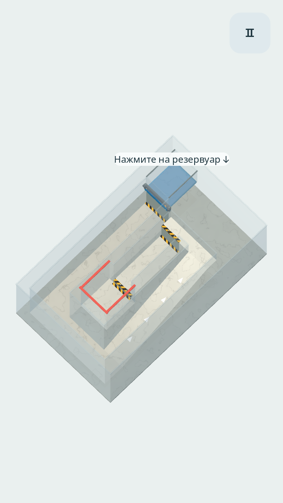

# Гидрологика / Hydrologic

Android-игра об управлении жидкостью наклоном телефона или вращением поля. **Версия 0.14.0: более связный поток, глубокий «Каскад», тугая пружинная заслонка, единые правила нагрева и светлый мраморный пол.** Цель — доставить не менее **80% исходной массы** в красный приёмник и удержать её **0,75 с**. На «Заморозке» принимается лёд, на остальных уровнях — вода.

Авторы: **Zakhar Govin и Codex (OpenAI)**. Они также указаны в разделе «Об игре».

## Скачать на Android

[Скачать ZIP с APK Hydrologic 0.14.0](https://codeload.github.com/zakgovin/LiquidGame/zip/refs/heads/downloads-v0.14.0) — распакуйте архив и откройте APK. Этот вариант подходит, если загрузка APK в браузере телефона зависает на 100%.

[Прямая ссылка на APK](https://github.com/zakgovin/LiquidGame/raw/refs/heads/downloads-v0.14.0/hydrologic-0.14.0-android.apk). Сборка и SHA-256 находятся в ветке [downloads-v0.14.0](https://github.com/zakgovin/LiquidGame/tree/downloads-v0.14.0). Прежние ссылки сохранены.

Тестовая debug-сборка: Android 7.0+ / API 24, OpenGL ES 3.0, ARM64 и x86_64. Работает офлайн, разрешений не запрашивает. Ключ подписи сохранён для обновления предыдущей установленной версии.

## Управление

1. Выберите уровень и способ управления в меню, нажмите «Играть». Вода или лёд ждут в закрытом резервуаре. Нажмите **на сам резервуар**, чтобы выпустить содержимое. Крышка вылетает; калибровка наклона происходит в момент открытия.
2. **«Наклон»**: первые 6° нейтральны, 36° дают полный ввод при чувствительности ×1. Поле плавно наклоняется вслед за телефоном до 9°; визуальный отклик отключается в настройках.
3. **«Вращение»**: ведите пальцем по кругу вокруг центра поля. Уровень вращается вокруг вертикальной оси под неподвижной ортографической камерой; гравитация направлена вниз экрана. Жест учитывает проекцию круга в эллипс, угол сохраняется после отпускания. Камера смотрит сверху под 65–73°; у новых уровней — 72°. Физическая сила в этом режиме постоянна; на «Узком горлышке» задан пологий наклон 0,2.
4. В геймплее видна только кнопка паузы. «Продолжить» сохраняет ориентацию, «Начать заново» возвращает исходное содержимое и закрывает источник, «Выйти» ведёт в меню. Сворачивание приложения включает паузу, включая нагрев и движение льда.
5. После доставки поток продолжает доливаться минимум полсекунды. Результат показывает доли исходной массы в приёмнике, на уровне и потерянные. «Следующий уровень» доступен до восьмого включительно; любой из девяти можно выбрать напрямую.

Язык, способ управления, чувствительность, звуки и визуальный наклон сохраняются. Настройки доступны на русском и английском, прокручиваются без видимой полосы; возврат закреплён внизу. Маршрут сохраняется по постоянному идентификатору; прежние индексы мигрируют с сохранением выбранного уровня.

## Уровни

| № | Название | Задача | Финальный приёмник |
| --- | --- | --- | --- |
| 1 | Первый виток | Спираль с полным оборотом | Открытый |
| 2 | Развилка | Короткая и длинная ветви, обратное движение | С обратным клапаном |
| 3 | Повороты | Плавные изгибы и проём во внешней стене; дно целое | Открытый |
| 4 | Узкое горлышко | Низкий проход, переливные борта и ловушки | С обратным клапаном |
| 5 | Каскад | Большой спуск, поворот, крутой подъём на 2,52 и новый спуск | **Открытый, без обратного клапана** |
| 6 | Импульс | Собрать и разогнать воду для сильного удара по тугой заслонке | **Открытый, без обратного клапана** |
| 7 | Горячая зона | Пройти нагреватель, ограничив потери пара | Защищённый, принимает воду |
| 8 | Заморозка | Заморозить воду в форме, провести лёд по решётке | Открытый, принимает лёд |
| 9 | Оттепель | Перевести лёд через решётку, растопить и быстро отвести воду от нагревателя | Открытый, принимает воду |

На «Импульсе» заслонка реагирует на импульс **самой воды**, после открытия фиксируется. На «Заморозке» индикатор охлаждения постепенно меняет цвет: перед решёткой нужно дождаться замерзания. Жидкость падает между прутьями и теряется, связный лёд перекрывает отверстия. На «Оттепели» температура и скорость нагрева такие же, как в «Горячей зоне»: вода быстро закипает, если задержаться. Тесный выход и перемычка удалены; широкий канал позволяет сразу отвести талую воду.

Уровни 1–6 содержат по 6144 маркера; 7–9 — по 3072 при том же размере маркера. Приёмники 5, 6, 8 и 9 позволяют обратный отток: смена направления может вылить уже доставленную воду. Десятый комбинированный уровень остаётся в плане.



[Пар над нагревателем](docs/phase-vapor.png) · [Замерзание](docs/phase-freeze.png) · [Таяние](docs/phase-thaw.png)

## Физика и изображение

Нативный C++ GDExtension рассчитывает объёмный поток на сетке MAC с переносом PIC/FLIP, проекцией давления и свободной поверхностью. Вязкость воды — 10⁻⁶ м²/с, поверхностное натяжение — 0,072 Н/м. Локальная симметричная капиллярная поддержка тонких струй действует в пределах 2,8 расстояния между маркерами и сохраняет парный импульс. Дополнительное парное сглаживание расхождения соседей на тонкой поверхности противодействует численному разрыву струи. Оно действует после расчёта давления, сохраняет парный импульс и не связывает уже удалившиеся капли. Сила тяжести, вязкость, скорость основного потока и предел остаточной скорости сохранены.

У пандусов непрерывная высота пола: одна геометрия задаёт изображение и столкновения. Для слоя тоньше ячейки используется движение по касательной, чтобы ступени вычислительной сетки не останавливали подъём. Защищённые сосуды сохраняют активные, видимые маркеры внутри. Победа считается от исходной массы, потери учитываются отдельно.

Температура и удельная энтальпия переносятся с каждым маркером. Замерзание и таяние расходуют скрытую теплоту при 0 °C, кипение — при 100 °C. Лёд образует твёрдые тела с сохранением расстояний, вращением, столкновениями и меньшей плотностью. Теплообмен постепенный. Пар поднимается отдельной фазой и считается потерей **после выхода за верхнюю границу**, а не при испарении. Перезапуск восстанавливает исходные состояния и температуры.

Вода и лёд имеют отдельные объёмные поверхности Zhu–Bridson / marching tetrahedra. Тонкая вода у пола восстанавливается вытянутым вдоль поверхности ядром с сохранением его локального объёма; это соединяет визуальный слой между физически взаимодействующими соседями. Летящие капли сохраняют объёмную форму; пар изображён полупрозрачными движущимися клубами. Стеклянные стенки имеют толщину и полированные кромки. Синяя вода отличается от нейтрального стекла и светлого матового мрамора, жёлто-чёрная разметка обозначает перепады. Объём поддерживают направленный свет, поглощение по глубине и контактное затемнение стен без динамической тени под уровнем. [Исследование читаемости и сравнение мрамора](docs/VISUAL_STUDY.ru.md).

Это игровая модель с ограниченным разрешением, а не инженерный расчёт гидродинамики и теплообмена. Другие жидкости, смешивание, разделение и конденсация пока не реализованы.

## Разработка

Godot **4.6.3 Standard**, GDScript и C++, Compatibility renderer. Linux x86_64: Python 3.11+ с pip, GCC/G++, binutils; для APK — полный JDK 21 и keytool.

```bash
export HYDRO_TOOLS="$HOME/.local/share/hydrologic-tools"
python3 scripts/setup.py --android
./scripts/godot.sh --headless --editor --import
./scripts/godot.sh --headless --script res://tests/run.gd
./scripts/build_android.sh
```

В managed cloud инструменты по умолчанию находятся в `/workspace/.hydrologic`. Setup проверяет контрольные суммы Godot, SDK, NDK r28b и godot-cpp 4.5; SCons закреплён на 4.9.1. Для разработки без Android достаточно `python3 scripts/setup.py`. После изменения C++ выполните `python3 scripts/build_native.py`; Android-скрипт обновляет библиотеки Linux, ARM64 и x86_64 атомарной заменой.

F5 запускает проект. В режиме наклона на компьютере доступны WASD / стрелки; для вращения — круговой жест мышью и Q / E. Esc — пауза / возврат, R — перезапуск.

```bash
# OpenGL и касания; требуется экран или Xvfb.
./scripts/godot.sh --audio-driver Dummy --resolution 720x1280 --script res://tests/visual.gd
./scripts/godot.sh --audio-driver Dummy --resolution 720x1280 --script res://tests/advanced_input.gd -- rotation
./scripts/godot.sh --headless --script res://tests/advanced_input.gd -- tilt

adb install -r build/hydrologic-0.14.0-android.apk
adb shell am start -n com.zakgovin.hydrologic/com.godot.game.GodotAppLauncher
```

Результат сборки — `build/hydrologic-0.14.0-android.apk`. Локальный debug-ключ не попадает в Git; новый ключ не позволит обновить прежнюю установленную сборку.

Проверки новых уровней проходят через игровой контроллер, физику, касание резервуара и фильтр датчика либо вращение поля. [Результаты и ограничения](docs/VALIDATION.md). На физическом Android-устройстве ещё требуется оценить FPS, нагрев, датчик и удобство новых механик.

| Файл | Назначение |
| --- | --- |
| `resources/*_level.tres` | Маршруты, высоты, резервуары и механики уровней |
| `resources/water.tres` | Свойства воды |
| `native/src/fluid.cpp` | MAC/PIC-FLIP, поверхность, рельеф и заслонка |
| `native/src/phase_system.inc` | Энтальпия, теплообмен, лёд и пар |
| `game/level_definition.gd` | Общая геометрия изображения и столкновений |
| `game/liquid_simulation.gd`, `game/fluid_surface.gd` | Интерфейс симуляции и отображение трёх фаз |
| `game/board.gd`, `game/main.gd` | Механизмы, сцена и состояния приложения |
| `i18n/ru.po`, `i18n/en.po` | Русский и английский интерфейс |
| `tests/run.gd`, `tests/phase_physics.gd` | Физика, фазовые переходы, UI и регрессии |
| `tests/visual.gd`, `tests/advanced_input.gd` | OpenGL, касания и прохождение через контроллер |
| `docs/SPECIFICATION.ru.md` | Концепция и план десяти уровней |

## Лицензии

Геометрия, иконка и интерфейс созданы для проекта. Меню вдохновлено Mirror’s Edge без использования её материалов. В игровом поле приоритет отдан читаемости. Godot и godot-cpp — MIT (`assets/GODOT-*.txt`); Noto Sans — SIL OFL 1.1 (`assets/fonts/OFL.txt`). Уведомления включены в APK.
