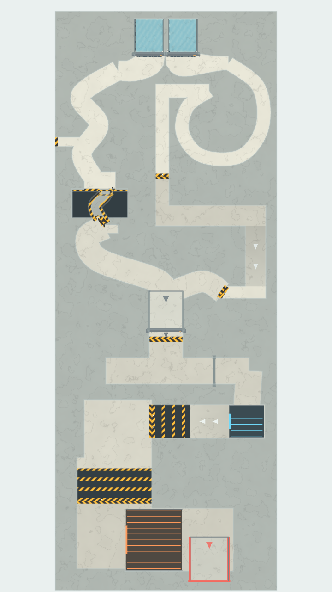
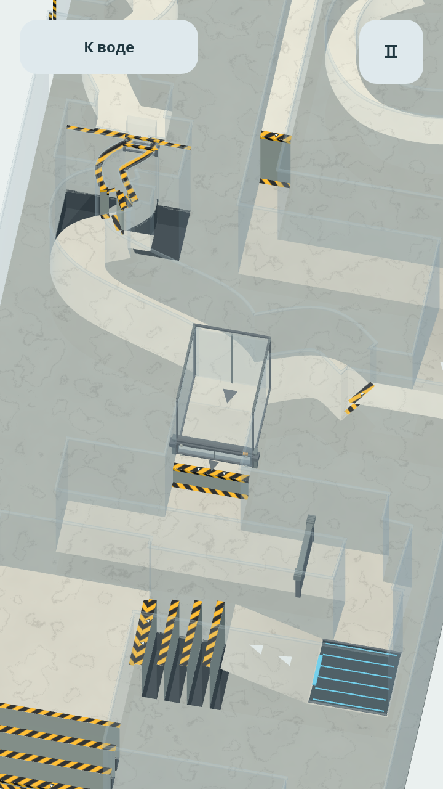

# Финал 0.16.0

Выходы двух начальных резервуаров имеют полную ширину 1,2 и плавно сужаются до каналов. Убраны углы пола, за которые цеплялась вода сразу за крышками.

Камера сопровождает оставшуюся воду независимо от заполнения накопителя. Кнопка «К накопителю» переводит её к промежуточному сосуду, «К воде» возвращает обратно. Переключение камеры не открывает крышку. Накопитель по-прежнему открывается отдельным нажатием на него после сбора 80% исходной воды. После открытия камера следует за общим потоком. В остальных уровнях поверх игры остаётся только пауза.

Накопитель сохраняет односторонний вход и после снятия крышки; на выходе добавлен отдельный обратный клапан. Решатель учитывает закрытие обратного потока на сетке и прохождение маркерами клапана. Вода остаётся активной и видимой, в промежуточном сосуде победа не засчитывается. После выхода сделан спуск на 0,5: воду для удара можно собрать на нижней площадке, не отправляя её обратно к входным каналам.

Левая ветвь получила два встречных изгиба, проход шириной 0,32 с низким перекрытием и борта высотой 0,14 над дном. Перед сужением есть площадка, за переливными кромками — настоящие ловушки. Проём во внешней стене S-образного участка соединён с каналом. Сильный прямой наклон больше не является безопасным способом пройти весь участок.

После заморозки нужно пройти две перпендикулярные решётки с ненагреваемыми площадками. Вторая решётка широкая, с последовательно опускающимися перекладинами. Перед нагревателем есть место полностью свести лёд с отверстий; выход нагревателя открыт на всю ширину, чтобы талая вода не задерживалась на горячей плите. Температура 200 °C и проводимость 4500 совпадают с прежними правилами нагрева. Габариты поля, 4096 исходных маркеров и оптимизация построения воды из 0.15.1 сохранены.

В «Об игре» на обоих языках указана пауза в развитии прототипа. Авторы: **Zakhar Govin и Codex (OpenAI)**.

## Проверки

Все проверки выполнены в Godot 4.6.3 на Linux с производственным C++ решателем; OpenGL — Mesa llvmpipe. Итоговые результаты и данные APK приведены в [VALIDATION.md](VALIDATION.md). Частота кадров и удобство на физическом Android этой сборкой пока не измерены.

В отдельной сцене испытания сужения из 2048 маркеров плавная подача потеряла 0 в ловушках и 269 вне них; постоянный полный наклон вперёд потерял 808 в ловушках. Баланс массы точен в обоих случаях. Это проверка опасности участка, а не результат полного прохождения. Общий участок от заполненного накопителя до финиша в отдельном прогоне доставил 3760 из 4096 маркеров (91,8%). Полный маршрут с двумя исходными порциями прошёл все 18 проверок: победа зафиксирована при 3321 / 4096 маркерах в цели (81,08%), 118 потеряно, 657 остаются на уровне. Ни одна частица не переставлялась и не заменялась; порог считается от всей начальной массы.
