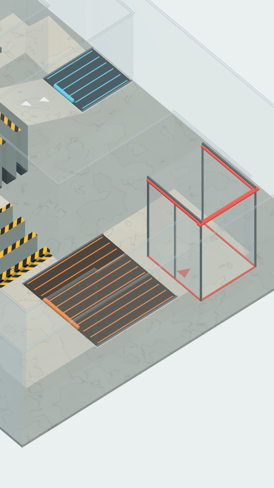

# Проверки прототипа

## Версия 0.16.1 — вход финального сосуда десятого уровня

Створки обратного клапана, верхняя перемычка и стрелка входа перенесены на левую сторону конечного резервуара, куда вода приходит после нагревателя. Створки открываются внутрь по потоку. Остальные резервуары сохраняют прежнюю ориентацию. Правка затрагивает отображение: маршрут, правила и физика воды сохранены, обе нативные библиотеки в APK побитно совпадают с 0.16.0. Развитие прототипа после этой правки на паузе.

Пройдены 21 проверка управления финала и просмотр в настоящем OpenGL. В отдельной сцене 256 маркеров вошли слева в конечный сосуд и сохранились после полного обратного наклона без потерь; отдельно проверена исходная ориентация входов уровней 2, 4 и 7. Ресурсы извлечены из APK и запущены с Linux-библиотекой: проверены версия и положение перенесённого клапана.

APK 0.16.1 / versionCode 21, Android API 24–36, ARM64 и x86_64, без запрашиваемых разрешений. Размер 61031701 байт, SHA-256: `67c09a79af7fe09aab5cca89dcc62689262fbabf9846dd973825b83aee08c7ae`. CRC архива и обе нативные библиотеки проверены. Подпись v2/v3 прежним сертификатом; установка поверх 0.16.0 сохраняется. Физический телефон этой сборкой пока не проверен.

## Версия 0.16.0 — камера, checkpoint и маршрут финала

[Описание изменений и карта](FINAL_0_16.ru.md). Исправлены полные выходы источников, ручной выбор камеры и удержание воды после открытия промежуточного сосуда. Левая ветвь получила опасное сужение с переливом, после накопителя добавлен спуск на 0,5, между заморозкой и нагревом — вторая решётка и безопасные площадки. Обновлены оба перевода раздела «Об игре».

- Пройдены 240 проверок физики/логики, 95 настоящего OpenGL/касаний, 17 оптики/объёма и 21 резервуаров/камеры/клапана. Планирование поверхности — 11 проверок. В 12 897 точках всех десяти уровней индексированная геометрия совпадает с определением уровня.
- Полный маршрут — 18 проверок, 0 ошибок. Две исходные порции проведены через обе ветви, накопитель, ударную заслонку, заморозку, обе решётки и нагрев без перестановки или замены маркеров. В момент фиксации игрового порога доставлено **3321 / 4096 = 81,08%**, потеряно 118, на уровне остаётся 657. Баланс исходной массы точен; результат не нормируется на уцелевший объём. Ещё один прогон той же геометрии с более долгим доливом доставил 3480 / 4096 = 84,96%. Победа в приложении сохраняет дополнительную паузу перед результатом.
- Изолированный общий участок из полного накопителя доставил 3760 / 4096 = 91,80%. Это отдельная сцена проверки механизмов, не подмена полного маршрута. Испытание сужения отдельно сравнивает плавную подачу и постоянный сильный наклон; оба сохраняют точный баланс массы.
- Проверены запрет обратного движения через вход и выход накопителя, удержание боковой границы после открытия, ручное возвращение к оставшейся воде и доступность ещё закрытого начального источника. Створки выходного клапана открываются по потоку при уменьшении наполнения.
- Габариты поля и число маркеров сохранены. Ограничение воды одним построением на показанный кадр, предел 30 Гц, индекс геометрии и кеш заслонки из 0.15.1 действуют; это не новый замер FPS телефона.

APK **0.16.0 / versionCode 20**, API 24–36, ARM64 и x86_64, без запрашиваемых разрешений. Размер **61031701 байт**, SHA-256: `c4262d7a11e37d66c46c108f71abe31483f8a8afb07c3287e85f9226984173de`. ZIP CRC исправен, обе нативные библиотеки и восемь шейдеров сверены с локальной сборкой. Подпись v2/v3 тем же сертификатом `9f25b2e50a6d2d36ea4cbeaa5c34ed92367a02da4cbace3ada3ca779f790d39e`. Ресурсы извлечены из APK и отдельно запущены с Linux-библиотекой: проверены скомпилированная сцена, два источника, ручная камера, спуск, вторая решётка и оба перевода. Это проверка упаковки, не запуск Android-бинарника на телефоне. Физическое устройство этой версией пока не проверено.

## Версия 0.15.1 — производительность финала

[Методика, сравнение CPU и проверка сохранения изображения](PERFORMANCE_0_15_1.ru.md). На изолированном стенде построение воды при открытом источнике финала ускорилось с медианы 78,09 до 30,74 мс, физический шаг — с 31,09 до 21,37 мс. Отрисовка больше не строит промежуточные сетки между двумя показанными кадрами. Прежние свойства и геометрия воды сохранены.

Повторно пройдены 240 проверок физики/логики, 95 OpenGL/касаний, 15 оптики/объёма, 14 независимых источников, 15 полного финала и 11 планировщика поверхности. Проверено 12 837 точек геометрии на всех десяти уровнях. В трёх контрольных сценах физические состояния и сетки побитно совпали с 0.15.0. Полный финал снова доставил 3879 / 4096 маркеров (94,70%), с тем же точным балансом массы.

APK: версия 0.15.1 / versionCode 19, Android API 24–36, ARM64 и x86_64. Подпись сохраняется для установки поверх предыдущей версии. Размер 61031701 байт; ZIP CRC исправен, обе нативные библиотеки и шейдеры сверены с исходной сборкой. SHA-256 APK: `eed0eb41882ed795543f7236043b8935484138ed8118b89ebf97ed9f0716bb16`. Замеры относятся к настольному стенду; физический Android ещё не проверен.

## Версия 0.15.0 — полный цикл и объёмная вода

**501 автоматическая проверка, 0 ошибок:** физика и логика — 240; интерфейс, касания и настоящий OpenGL — 95; уровни 5–9 через фильтр датчика — 61; через контроллер вращения — 61; объём и оптика воды — 15; независимые резервуары и камера финала — 14; полный маршрут финала — 15. Это настольные проверки Godot 4.6.3 с производственным C++ решателем. Проверки контроллеров выполнялись без рендера, OpenGL проверен отдельно на Mesa llvmpipe.

- **Финал:** «Полный цикл» доступен десятым. Две отдельные начальные половины по 2048 маркеров приходят по разным ветвям в защищённый накопитель; далее следуют ударная заслонка, охлаждение, решётка, ненагреваемая площадка, таяние и защищённый приёмник. Это одна сцена и один решатель. Нажатия открывают только выбранную крышку, повторные открытия не меняют калибровку. Наполнение накопителя не засчитывается как победа. Начальный ракурс охватывает обе ветви, дальнейшая камера сопровождает активную воду; проверено вращение после смещения камеры.
- **Полный маршрут финала:** без перестановки или пересоздания частиц проведены обе исходные порции, накопитель, заслонка, заморозка, решётка и нагреватель. Доставлено **3879 / 4096 = 94,70%**, на уровне осталось 204, потеряно 13. Баланс исходной массы точен; результат не нормируется на уцелевший объём. Все 15 проверок непрерывного прохождения выполнены.
- **Общий участок финала:** в отдельной исходной сцене с 4096 маркерами внутри накопителя медленная подача не открывает заслонку, сильный собранный поток открывает. После реальной заморозки, решётки и нагревателя доставлено **3973 / 4096 = 97,00%**, потеряно 123; каждая исходная частица учтена. Это проверка общего участка, отдельно от полного маршрута. Из этих потерь 2 относятся к численному контакту на границе решётки при таянии: мелкие контакты льда с геометрией остаются ограничением дискретной модели.
- **Объём воды:** допустимые маркеры у кривой стенки больше не выпадают из передачи давления из-за того, что центр их вычислительной ячейки находится в твёрдом теле. Локальное перераспределение работает только при чрезмерном уплотнении. После 12 секунд разнонаправленного удержания двух закрытых секций — 1024 активных маркера, 1024 различных положения, максимум 25 в ячейке 0,07. Объём нарисованной сетки 0,05048 при физически представленном 0,05619: вода не схлопывается в невидимую точку.
- **Оптика:** толщина вдоль лучей сохраняет интегральный объём с относительной ошибкой меньше 10⁻⁵ при смене камеры. Глубокая и тонкая сцены с одинаковой массой различаются по оптической толщине; передаётся знаковая скорость потока. Настоящая отдельная капля остаётся видимой, её нарисованный объём совпадает с объёмом маркера в пределах 2%. В сравнении одного кадра с водой и без неё — 9467 отсчётов, средняя разница яркости 0,140 и превышение синего над красным 0,161. Динамические проекционные тени не возвращены. [Кадр воды](water-v015.png), [изменения и ограничения](WATER_0_15.ru.md).
- **Прежние уровни:** ресурсы геометрии 1–9 и `water.tres` побайтово сохранены. После исправления реального распределения объёма прежняя запись полного ввода на «Поворотах» доставляет 86,49%, теряет через борт 747 из 6144 маркеров; через игровой датчик доставляется 91,85%, теряется 370, утечек сквозь геометрию нет. Проверка записи теперь использует игровой бюджет потерь 20%, а не прежнее более строгое требование; для «Узкого горлышка» проверяется сохранение более 90%. Для проверки опасного проёма используется отдельный пакет воды на его реальном поддерживающем дне. Запись «Заморозки» слегка центрирует более объёмный блок при подъёме, не меняя уровня: она проходит и наклоном, и вращением.
- **APK:** 0.15.0 / versionCode 18, 61 011 221 байт, min API 24, target API 36, ARM64 / x86_64, без разрешений. ZIP CRC исправен; обе нативные библиотеки и все шейдеры побайтово сверены со сборкой. Упакованные скрипты и ресурсы отдельно загружены в Godot с Linux-библиотекой: подтверждены десять уровней, независимые источники, прямой подвод к заслонке и понижающиеся поперечины решётки. Подпись v2/v3 сохранена; SHA-256 сертификата `9f25b2e50a6d2d36ea4cbeaa5c34ed92367a02da4cbace3ada3ca779f790d39e`. SHA-256 APK: `3ea01d3994c9df69e5bfbd94857b162c1383f6319df31392ce7d5683b0fa68dd`.
- **Локализация:** 68 одинаковых непустых ключей RU/EN. Авторы — Zakhar Govin и Codex (OpenAI).

На физическом Android-устройстве эта версия пока не проверена; FPS и нагрев не измерены. Естественность воды на глаз требует повторной записи с телефона по [критериям видеоразбора](WATER_REVIEW.ru.md); число автоматических проверок не доказывает реализм жидкости.

## Версия 0.14.0 — связность воды, сложность и мрамор

**472 проверки, 0 ошибок:** физика и логика — 239, прежние уровни и OpenGL — 95, новые уровни через фильтр датчика — 61, через вращение и настоящий OpenGL — 77. Проверки настольные, с тем же C++ решателем; это не замер физического телефона.

- **Вода:** капиллярная поддержка применяется после проекции давления и участвует в переносе маркеров. Дополнительные симметричные импульсы гасят расхождение соседей на тонкой поверхности. Связи пересчитываются на каждом шаге и ограничены радиусом; отдельные далёкие капли остаются баллистическими. Вязкость, гравитация, предел скорости и общий темп сохранены. В контрольном спокойном потоке максимум изолированных маркеров снизился с 1,2858% до 1,2207%, среднее по четырём одинаковым моментам — с 0,6104% до 0,4924%. Это приблизительно 19% по среднему; улучшение не гарантируется для каждого кадра.
- **Тонкая поверхность:** мокрый слой у пола восстанавливается анизотропным ядром с сохранением произведения полуосей, а летящие капли и лёд — исходным объёмным ядром. Это устраняет визуальные разрывы между физически взаимодействующими соседями. Проверены конечность сетки, объём в установленном допуске и покрытие растянутого слоя.
- **Каскад:** нижняя отметка −1,12, верхняя +1,40; подъём вырос с 1,12 до **2,52** на длине 5,3. В физической проверке ввод 0,55 не поднимает каплю, полный ввод поднимает её более чем на 1,2. Через оба игровых контроллера более 60% исходных маркеров действительно опускаются ниже −0,90 и поднимаются выше +1,25.
- **Импульс:** порог удерживающего момента увеличен с 8 до **128**, пружина — с 8 до 14. Стартовый поток оставляет створку закрытой; слабый поток 0,3, умеренный 1,2 и одна быстрая капля не открывают её в контрольных проверках. Плотная струя 2,8 открывает и фиксирует механизм. Открытие вызывается водой, не событием датчика.
- **Заморозка:** финальный приёмник открыт, без крышки, обратного клапана и скрытой фиксации. Порог считает лёд. Ровный выступ на скриншоте воспроизведён: 126 вершин реконструкции уходили до внешней стенки, хотя частицы оставались в канале. Ограничение расстояния проекции и допуск ближайшего пола устранили выступ: проверяется готовая сетка неподвижного льда после замерзания, включая отсутствие длинных треугольников через стену.
- **Оттепель:** нагреватель использует те же **200 °C / 4500**, что «Горячая зона». Одна и та же вода за одинаковое время получает одинаковую энергию в обоих уровнях. Долгая остановка после таяния приводит к кипению; быстрый перенос позволяет пройти. Узкий проход расширен до обычного канала 1,4, перемычка удалена, финальный приёмник открыт.
- **Открытые сосуды:** отдельные проверки подтверждают реальный обратный выход воды и льда на уровнях 5, 6, 8 и 9. Скрытого захваченного объёма нет. Защищённые сосуды уровней 2, 4 и 7 сохранены; исправлен пограничный приём воды у бортика, чтобы доставка и захват не расходились на один маркер.
- **Мрамор:** сравнены три рисунка одной замороженной сцены; выбран слабый матовый вариант. Рисунок закреплён на геометрии и вращается вместе с ней. Высотная градация, контактное затемнение, функциональные тепловые панели и разметка сохранены. Динамические тени не добавлены. [Кадры и воспроизведение](VISUAL_STUDY.ru.md).

| Уровень | Доставлено наклоном | Доставлено вращением |
| --- | --- | --- |
| 5 | 100.00% | 100.00% |
| 6 | 98.32% | 96.78% |
| 7 | 92.77% | 90.30% |
| 8 | 92.32% | 88.80% |
| 9 | 99.93% | 99.54% |

На каждом этапе проверены конечные координаты, отсутствие утечек сквозь целую геометрию и сумма воды, льда, пара и потерь. Пауза, повтор, сохранение выбранного маршрута, язык, звук и навигация проходят регрессии. Все девять уровней доступны напрямую.

APK **0.14.0 / versionCode 17**, min API 24, target API 36, ARM64 / x86_64, без запрашиваемых разрешений. Обе библиотеки, восемь шейдеров, девять уровней и ресурс шумовой текстуры мрамора сверены с экспортированными файлами. CRC исправен, ELF LOAD-сегменты выровнены на 16 КиБ. Подпись v2/v3 и сертификат `9f25b2e50a6d2d36ea4cbeaa5c34ed92367a02da4cbace3ada3ca779f790d39e` сохранены. Размер **60937123 байт**, SHA-256: `6cac7ad3bc2927819dc9641fbeb58b0783044dd13856056a2f14dbc544067daf`.

Проверки выше выполнялись автором на настольном runtime. После публикации пользователь прислал запись прохождения первого уровня на телефоне: 99,0% в сосуде, 1,0% на уровне, без показанных потерь. Геометрия уровней 1–9 признана достаточной для прототипа, но внешний вид воды не принят: она всё ещё выглядит как плёнка, а не убедительная объёмная жидкость. [Разбор записи и отдельные критерии следующей итерации](WATER_REVIEW.ru.md). Измерений FPS, нагрева и датчика на физическом устройстве нет. Игровая физика и поверхность приближённые; автоматические проверки не подтверждают визуальную реалистичность.

## Архив: версия 0.13.0 — пять новых уровней и три состояния воды

Проверено 2 ноября 2026 года в cloud-среде. **460 основных проверок, 0 ошибок:** `tests/run.gd` — 231 (в том числе 31 проверка фаз и механизмов), `tests/visual.gd` — 95 с настоящим OpenGL, `tests/advanced_input.gd -- tilt` — 59 и `-- rotation` — 75 с OpenGL и кадрами. После усиления видимости пара дополнительно пройден сценарий седьмого уровня: 17 проверок, 0 ошибок. Ниже — результаты настольного runtime той же игры, не измерения физического Android-устройства.

- Доступны девять уровней. Проверены меню, последовательные переходы до девятого, отсутствие перехода на несуществующий десятый, повтор и восстановление девятого по постоянному идентификатору после нового запуска. Оба каталога локализации содержат 66 одинаковых непустых ключей.
- **Каскад:** большие перепады вниз → вверх → вниз и повороты. В тесте отслеживаются те же маркеры: более 60% исходной воды действительно опускаются ниже −0,20 и затем поднимаются выше +0,60 на пандусе. Отметки маршрута: +0,84 → −0,42 → +0,70 → +0,14 → −0,14. [Кадр уровня](cascade.png).
- **Импульс:** слабый поток и отдельная быстрая капля не открывают заслонку; плотная быстрая струя открывает её и переводит в фиксированное положение. Импульс рассчитан по контакту воды, датчик телефона механизмом не управляет. Повтор закрывает и взводит заслонку.
- **Открытые приёмники 5 и 6:** отсутствуют крышка и обратный клапан. Физическая проверка показывает реальный обратный выход воды при смене направления; захваченного объёма нет.
- **Горячая зона:** постепенный нагрев, скрытая теплота кипения, подъём активного пара. Масса не удаляется при испарении; потери пара возникают после выхода за верхнюю границу. Задержка на настоящем нагревателе доводит исходную воду до кипения и выхода паром. [Поднявшийся пар](phase-vapor.png).
- **Заморозка:** охлаждение и скрытая теплота плавления создают связные твёрдые тела. Жидкость падает между прутьями той же решётки, ледяной блок сохраняет жёсткость и перекрывает отверстия. Приёмник принимает только лёд и фиксирует тело после полного входа; блок, ещё пересекающий вход, не вызывает преждевременную победу. Обратные наклоны сохраняют видимый лёд внутри сосуда, расстояния между маркерами и массу. [Охлаждаемая форма](phase-freeze.png).
- **Оттепель:** исходный лёд при −12 °C проходит решётку, постепенно тает на нагревателе, жидкая фаза проходит под низкой перемычкой. В обоих режимах перед доставкой наблюдаются лёд и вода одновременно; в конце исходные 3072 маркера переходят в воду, без потерь сквозь рельеф. [Начало таяния](phase-thaw.png).

| Уровень | Доставлено наклоном | Доставлено вращением |
| --- | --- | --- |
| 5 — Каскад | 100% | 100% |
| 6 — Импульс | 80,84% | 97,41% |
| 7 — Горячая зона | 94,69% | 92,74% |
| 8 — Заморозка | 91,18% льда | 92,61% льда |
| 9 — Оттепель | 93,46% | 91,67% |

Это воспроизводимые сценарии действий игрока через настоящий игровой контроллер: касание источника, фильтр датчика либо вращение поля. Доставка считается от исходной массы; на каждом этапе проверяются конечность координат и сумма воды, льда, пара и потерь. Потерь сквозь целую геометрию на новых маршрутах нет. Пауза останавливает движение и тепловые процессы, повтор восстанавливает исходную фазу.

Сцепление тонких струй усилено: радиус локальной поддержки увеличен с 2,25 до 2,8 расстояния между маркерами, сила — вдвое. Симметричные парные импульсы сохраняют горизонтальный импульс; удалённые капли продолжают двигаться баллистически. Вязкость, коэффициент поверхностного натяжения, основной темп течения и прежний предел численной остаточной скорости сохранены. Максимальная доля изолированных маркеров в контрольном спокойном потоке — 1,2858%; прежний абсолютный предел отделившегося объёма соблюдён. Этот показатель не означает уменьшение брызг в каждом кадре.

Под обновлённое течение верх низких бортов «Узкого горлышка» изменён с 0,70 до 0,72 при дне 0,42. Спокойная подача теряет 33 из 6144 маркеров (0,54%); полный наклон переливает более 20% в ловушки. На «Поворотах» плавная физическая траектория теряет 44 маркера (0,72%), удержание наружного направления — 1485 (24,17%), что делает попытку непроходимой. Прежние игровые маршруты, масса, пауза, калибровка, наклон поля, обе схемы управления, задержка результата, локализация и звук проходят проверки.

APK **0.13.0 / versionCode 16**, min API 24, target API 36, ARM64 / x86_64, без запрашиваемых разрешений. Обе нативные библиотеки, семь шейдеров и девять упакованных ресурсов уровней побайтово сверены с локальной сборкой; ZIP CRC исправен. Выравнивание ELF LOAD-сегментов — 16 КиБ. Подпись v2/v3, SHA-256 сертификата: `9f25b2e50a6d2d36ea4cbeaa5c34ed92367a02da4cbace3ada3ca779f790d39e`, совпадает с предыдущей опубликованной версией. Размер **60936810 байт**, SHA-256 APK: `482ddf7f1df6e9b0c3e29fc88cc49a047c9f03a762015b25569dcc3dcba1df8f`.

Физический телефон с этой версией ещё не проверялся. Нужны оценка датчика, FPS, нагрева и удобства новых механик на устройстве. Физика фаз — игровое приближение; конденсация, другие жидкости и десятый уровень пока не реализованы.

## Архив: версия 0.12.1 — порядок сложности и перелив у горлышка

- **195 проверок физики и логики и 95 проверок OpenGL, интерфейса и касаний — 290 проверок, 0 ошибок.** После смены индексов сценарий датчика дополнительно повторён именно на «Поворотах», выбираемых по ресурсу, а не по прежнему номеру.
- Порядок в меню и после победы: **«Первый виток» → «Развилка» → «Повороты» → «Узкое горлышко»**. Выбор сохраняется по постоянному идентификатору источника. Для всех четырёх прежних индексов проверяется миграция с сохранением того же маршрута; новый запуск восстанавливает выбор по идентификатору.
- У **«Узкого горлышка»** удалены оба наружных боковых слива. С обеих сторон отверстия **0,48 × 0,22** стоят низкие стеклянные борта: **0,28 над дном** (верх 0,70, дно 0,42). За ними находятся две ловушки шириной **1,04** и длиной **0,94**. Между ловушками сам проход сохраняет целое дно и высокие удерживающие стенки толщиной 0,12; спокойная струя не должна падать с его боков. Тёмные шахты и жёлто-чёрные кромки показывают опасную область. [Исправленный уровень](bottleneck-low-banks.png).
- Сильный ввод **строго вперёд**, без наклона вбок, переливает больше **20% исходной воды** через низкие борта в ловушки и делает попытку непроходимой. Спокойный ввод 0,2 проходит с потерями **меньше 1%**. В обоих случаях проверяется баланс доставленного, оставшегося и потерянного; перелив учитывается как потеря в ловушках, утечек сквозь целую геометрию нет. Отдельные капли ниже каждого борта удерживаются, выше борта — переливаются и исчезают в шахте.
- Через игровые касания резервуара и контроллер вращения все четыре уровня завершаются победой. На «Поворотах» датчик, фильтр и игровой цикл доставили **90,951%**, потеряно 70 маркеров. На горлышке доставлено **89,388%**, потеряно **30 из 6144 маркеров (0,488%)**; весь потерянный объём попал в ловушки, утечек сквозь рельеф нет. Пауза, задержка результата, повтор и переходы сохраняют прежние правила.
- Режим **«Вращение»** управляет направлением постоянной силы, а не её величиной. Для горлышка задан пологий физический наклон **0,2** от полного ввода (около 7° в модели); этот режим проверяется через реальный игровой контроллер с тем же значением. На остальных маршрутах сила вращения сохранена. В режиме **«Наклон»** полный диапазон остался прежним: сильный наклон действительно опасен. Это авторская настройка уровня, а не ослабление силы только в тесте.
- После горлышка убраны криволинейные границы между этажами: изгиб лежит на одной отметке, перед приёмником прямые ступени. Разметка всех уровней обрезается по реальным верхним и нижним площадкам: **0,12 сверху, 0,10 снизу**, нижняя штриховка развёрнута. На вертикальной грани полоса занимает верхние **0,075**; остальная поверхность спокойного цвета сохраняет объём без широких цветных стен. Стрелки рисуются, только если целиком помещаются на полу. Для горлышка и развилки проверяются центры всех треугольников разметки: высота соответствует настоящему полу. [Исправленная развилка](fork-step-markings.png).
- Геометрия развилки и «Поворотов», свойства воды, локальная капиллярная поддержка и стартовый объём **6144 маркера** сохранены. Русский и английский каталоги содержат 56 одинаковых непустых ключей; описание горлышка объясняет перелив через низкие борта.
- APK **0.12.1 / versionCode 15**, min API 24, target API 36, ARM64 / x86_64, без разрешений. Обе нативные библиотеки, пять шейдеров и четыре упакованных ресурса уровней побайтово сверены; ZIP CRC исправен. Подпись v2/v3 совпадает с 0.12.0. Размер **60 796 279 байт**, SHA-256: `b3a2a0aed5512b04d28bb1faedfd92c84bf0ea29488a02997e09e9f3a4ba0602`.

Версия 0.12.1 пока не проверялась на физическом Android-устройстве. Автоматические сценарии и изображения относятся к настольному запуску той же игры; они не измеряют FPS и нагрев телефона.

## Архив: версия 0.12.0 — горлышко, развилка и удержание воды

- **183 проверки физики и логики и 96 проверок OpenGL, интерфейса и касаний — 279 проверок, 0 ошибок.**
- Добавлены **«Узкое горлышко»** и **«Развилка»**, доступны напрямую и через последовательные переходы. В первом случае вода проходит через отверстие **0,48 × 0,22** под настоящей перемычкой; два боковых выхода позволяют расплескать её при неправильном управлении. Во втором поток физически делится между двумя отдельными криволинейными ветвями. Короткая приходит первой, длинная требует возвратного движения. [Горлышко](bottleneck-flow.png) · [Развилка](fork-split.png).
- Стартовое количество воды на **всех четырёх уровнях** уменьшено с 8192 до **6144** равных маркеров при прежнем размере: **−25% физического объёма**, с 0,449511424 до 0,337133568 м³ в единицах сцены. Это масштаб игрового стенда. Порог победы остаётся 80% исходного объёма.
- Добавлена локальная капиллярная поддержка тонких струй в пределах **2,25 расстояния между маркерами**. Симметричные парные импульсы сохраняют суммарный импульс; вязкость **10⁻⁶ м²/с**, натяжение **0,072 Н/м**, скорость основного потока и баллистика удалённых капель сохранены. Проверка сравнивает близкую пару с включённой и выключенной поддержкой: расстояние после полусекунды уменьшается более чем на 35%, импульс по горизонтали сохраняется. При разнесении на 0,2 результат совпадает с исходной моделью. За первую секунду контрольного потока путь центра массы 1,82694 против 1,82695 без поддержки: замедления потока нет.
- В регрессионном спокойном потоке наибольшая доля изолированных маркеров **1,2044%** (74 из 6144); в конце — 0,2116%. Проверка сохраняет прежний **абсолютный** предел отделившегося объёма, соответствующий 1% прежних 8192 маркеров, а не меняет его вместе со стартовым заполнением. Это не обещание меньшего количества брызг в каждом кадре: в контрольном прогоне без локальной поддержки при таком же заполнении кратковременный максимум был 0,9603%. Изменение направлено на сцепление тонких близких струй; реальные потери и оторванные капли продолжают учитываться.
- Новые безопасные приёмники используют крышку и обратный клапан. Доставленные маркеры остаются **активными, видимыми и физически внутри сосуда**; они участвуют в расчёте давления, не удаляются и не подменяют счётчик доставки. При смене направления гравитации клапан закрывает обратный поток. Стеклянные створки открываются при поступлении воды. На уровнях 1 и 2 приёмники сохраняют прежнее поведение.
- Физический маршрут третьего уровня доставил **85,758%**, четвёртого — **88,574%**, без потерь. Через реальные касания резервуара и игровой контроллер вращения доставлено **94,906%** и **96,777%**, также без потерь. На развилке первая порция составляет около 48%, и требуется собрать длинную ветвь. Баланс доставленного, оставшегося и потерянного объёма проверяется на каждом этапе.
- Неправильный диагональный ввод у горлышка теряет **1959 из 6144 маркеров (31,885%)** через боковой выход и делает попытку непроходимой. Проверены отдельно оба выхода, проход под перемычкой и столкновение выше отверстия. Потерь сквозь целую геометрию нет. Для обоих защищённых сосудов 256 контрольных маркеров удерживаются внутри при четырёх направлениях гравитации; построенная поверхность остаётся в пределах приёмника, перезапуск очищает накопление.
- Первый маршрут доставил **92,285%**. Второй с уменьшенным объёмом — **89,746%** в физической проверке, **90,951%** через датчик, фильтр и игровой цикл и **94,645%** через вращение. Геометрия и безопасное расположение бокового проёма второго уровня сохранены; тестовый сценарий собирает оставшийся хвост дополнительным плавным возвратом.
- Русский и английский каталоги содержат **56 одинаковых непустых ключей**. Проверены выбор четырёх уровней, переходы, пауза, перезапуск, полусекундная задержка результата, сохранение настроек, звук и отсутствие динамических теней.
- APK **0.12.0 / versionCode 14**, min API 24, target API 36, ARM64 / x86_64, без разрешений. Обе нативные библиотеки, пять шейдеров и все четыре упакованных ресурса уровней побайтово сверены; ZIP CRC исправен. Подпись v2/v3 совпадает с 0.11.2. Размер **60 796 279 байт**, SHA-256: `626d5658b8646a6d4811369e622b6764e94094e12fc327d3ad572d7f9bc72e90`.

Версия 0.12.0 пока не проверялась на физическом Android-устройстве. Сценарии проходят через нативную физику и реальный настольный OpenGL-рендер; они не заменяют проверку датчика, FPS и нагрева телефона.

## Архив: версия 0.11.2 — более прощающий боковой проём

- **144 проверки физики и логики и 78 проверок OpenGL, интерфейса и касаний — 222 проверки, 0 ошибок.** Оба уровня, оба режима управления, выпуск, пауза, доливание и локализация сохранены.
- Начало проёма сдвинуто выше по каналу: **с 1,75 до 1,10**. Его протяжённость уменьшена **с 0,65 до 0,18**, чтобы дать запас при спокойном управлении. Прежнее место восстановлено сплошным бортом; дно осталось непрерывным. Два предупреждающих торца и разметка пола следуют за новой геометрией. [Обновлённый уровень](second-bank.png).
- На **одинаковом плавном сценарии** со скоростью смены направления 1,4 рад/с старое расположение из 0.11.1 потеряло **1804 из 8192** маркеров (**22,021%**), новое — **147** (**1,794%**). С новым проёмом сценарий завершается победой. Дополнительно при скорости 2 рад/с сохранено **96,814%** воды и тоже достигнута цель.
- При быстрых сменах направления (3,5 рад/с) с удержанием наклона наружу потеряно **2038** маркеров (**24,878%**). Попытка становится непроходимой: через проём действительно можно вылить воду. Потери не скрываются и не нормируются на оставшийся объём.
- Физический плавный сценарий доставил **82,874%**, остальная вода находится на уровне или потеряна за краем. Через датчик, фильтр и игровой цикл доставлено **82,874%**, потеряно **169** маркеров; через игровые касания и вращение — **83,374%**. Оба режима заканчиваются победой. Баланс доставленного, оставшегося и потерянного объёма точен; потерь через пол или сплошную геометрию нет.
- Проверки геометрии подтверждают новое положение проёма, закрытие прежнего места, целый пол, совпадение высот в **3150 точках**, опору под неподвижной каплей и удержание воды соседней целой стенкой. В регрессионной проверке плавный проход должен сохранять **более 97%** воды.
- Физическая модель и её параметры, камера и управление приложения не менялись. Плавный и резкий сценарии различаются только тестовым вводом игрока. Внешний вид воды и стекла сохранён.
- APK **0.11.2 / versionCode 13**, min API 24, target API 36, ARM64 / x86_64, без разрешений. Обе нативные библиотеки, пять шейдеров и упакованный изменённый ресурс уровня побайтово сверены; ZIP CRC исправен. Подпись v2/v3 совпадает с 0.11.1. SHA-256: `45371b7edb6111b8a3632bd2f39d800b0acb8152e4d71099b0fde5c94f3c1a70`.

Версия 0.11.2 пока не проверялась на физическом Android-устройстве; показатели плавного и резкого управления относятся к воспроизводимым сценариям, а не гарантированному результату любой траектории.

## Архив: версия 0.11.1 — проём во внешнем борту

- **144 проверки физики и логики и 78 проверок OpenGL, интерфейса и касаний — 222 проверки, 0 ошибок.** Сохранены первый уровень, оба способа управления, локализация, пауза, выпуск и задержка результата.
- Исправлено неверное понимание задачи: **отверстие в полу удалено**, желоба соединены непрерывным ступенчатым дном. Проём шириной **0,65** находится в наружном борту нижнего изгиба. Вода проходит уровень по полу; прыжок, лёд или переброс через пустоту не нужны.
- В **3150 точках** совпадают высоты нативной геометрии и ресурса. Проверены отсутствие внутренних отверстий, непрерывность бывшего разрыва, сохранённый пол у проёма и высота соседней целой стенки. Одиночная капля стоит у проёма без проваливания; наклон наружу выливает её, а соседний целый борт удерживает при том же вводе.
- Край открытого борта и **два вертикальных торца** отмечены чёрно-жёлтой разметкой. Под проёмом нет ложной нижней площадки со стрелкой, предлагающей вылить туда воду. [Кадр исправленной геометрии](second-bank.png).
- При плавной смене направления физический сценарий доставил **82,874%**, потеряно за край **480 из 8192** маркеров. Слишком долгое удержание направления наружу доставило **29,529%**, потеряно **5422** маркера, повторная попытка необходима. В обоих сценариях потерь через отверстия в полу и сплошную геометрию **0**; доставленное + оставшееся + потерянное равно исходным 8192.
- Через имитацию датчика, фильтрацию и игровой цикл доставлено **81,152%**. Через касания резервуара и контроллер вращения — **80,286%**. Оба сценария заканчиваются победой с обычной водой, без подмены результата или нормирования на уцелевший объём.
- Учёт потерь использует высоту **реального края** в месте пересечения границы поля. Выливание через отсутствующий борт ниже общего верха стен не ошибочно считается утечкой сквозь геометрию. Само движение и свойства жидкости сохранены.
- Описание второго уровня обновлено на русском и английском; **52 одинаковых непустых ключа**. Палитра, освещение, остальные уровни и режимы управления сохранены.
- APK **0.11.1 / versionCode 12**, min API 24, target API 36, ARM64 / x86_64, без разрешений. Обе нативные библиотеки, пять шейдеров и упакованный исправленный ресурс уровня побайтово сверены; ZIP CRC исправен. Подпись v2/v3 совпадает с 0.11.0. SHA-256: `513a15ed7bd8a4d2fbbd66539d8b608ae1145d68dee08b6207ea9f98b999722e`.

Пользовательская запись 0.11.0 просмотрена: вода действительно терялась через ошибочно сделанное отверстие в полу. Версия 0.11.1 пока не проверялась на физическом Android-устройстве; аппаратные FPS и нагрев не измерены.

## Архив: версия 0.11.0

- **138 проверок физики и логики и 76 проверок OpenGL-рендеринга и касаний — 214 проверок, 0 ошибок.** Сохранены первый уровень, датчики, оба языка, жесты, пауза, выпуск, доливание и переходы между уровнями.
- [Исследование материалов](VISUAL_STUDY.ru.md): три варианта одной замороженной сцены. Выбран тёплый пол, нейтральное стекло, синяя вода, направленное освещение и узкое контактное затемнение у основания стен. Светотень работает на форме, а динамических проекционных теней под полем нет. Сохранён отрицательный тест с невидимым объектом и положительный контроль с явно включённой тенью.
- В кадре игрового потока среднее превышение синего над красным **0,236**, яркость и отличие от сухого пола удовлетворяют оптической проверке. Прежнее требование «потемнение не больше 10%» удалено: оно не проверяло объём и способствовало чрезмерному высветлению воды.
- Второй уровень построен по **четырём кривым Безье**, с настоящими плавными стенками и их столкновениями. Совпадение нативной высоты и ресурса проверено в **3150 точках**; совпадение видимых полов — с допуском на микроскопические погрешности отсечения полигонов. Внутренние участки маршрута проверены лучами к камере в **36 положениях** поворота. Ракурс второго уровня — 70° сверху, первого — 65°.
- Между верхним желобом и нижним приёмным участком есть разрыв **0,18**, перепад — **0,28**. В проёме нет скрытого пола, стеклянного моста или подложки. Одиночная капля действительно падает через него; направленная струя долетает до нижнего пола. Промах сохраняет происхождение потери через проём, даже если капля затем пролетает под приёмным желобом.
- Плавный физический сценарий доставил **96,191%**, потеряно через проём **127 из 8192** маркеров. В сценарии с запоздалым поворотом доставлено **62,5%**, через проём потеряно **3072** маркера: попытка становится непроходимой. Потерь через сплошную геометрию в этих сценариях **0**. Баланс доставленного, оставшегося и потерянного объёма точен.
- Через имитацию датчика телефона, фильтр и игровой цикл доставлено **91,479%**, потеряно **169** маркеров. Через игровые касания резервуара и контроллер вращения — **94,177%**. Первый уровень через тот же контроллер доставил **97,388%**. Это разные сценарии выпуска и доливания, результаты не нормируются на уцелевшую воду.
- Поиск ближайших криволинейных стен используется и при столкновениях, и при построении поверхности. Кромки объединены в сетку; не создаётся отдельный объект на каждый сегмент кривой. Свойства физики воды сохранены.
- Русский и английский каталоги содержат **52 одинаковых непустых ключа**; описание второго маршрута обновлено.
- Автономная Linux-сборка запущена вне исходников: сохранённый второй уровень, кривые и пять материалов загрузились, контрольный кадр сохранён.
- APK **0.11.0 / versionCode 11**, min API 24, target API 36, ARM64 / x86_64, без разрешений. ZIP CRC исправен; обе нативные библиотеки и **пять** шейдеров побайтово сверены с исходной сборкой, ресурс второго уровня включён. Подпись v2/v3 совпадает с 0.10.0. SHA-256: `0c63c9e79a3cf212d31436c6a8b9199e13dc77bfa74d597d7469eed456da0225`.

Присланная запись 0.10.0 использована для анализа потери объёма воды и сходства её цвета со стеклом. Версия 0.11.0 пока не проверялась на физическом Android-устройстве; FPS и нагрев не измерены.

## Архив: версия 0.10.0

- **128 проверок физики и логики и 75 проверок OpenGL-рендеринга и касаний — 203 проверки, 0 ошибок.** Дополнительно проверены второй маршрут, выбор обоих уровней, восстановление выбора при новом запуске, отдельные источники, переход после победы и отсутствие следующего уровня за концом списка.
- Динамические тени отключены у направленного света и всех деталей, включая крышку и крепления. Плоскость под полем удалена; фон задаётся окружением, заполнение света увеличено для сохранения читаемости. В тесте невидимый объект, способный отбрасывать тень, даёт **0 изменённых отсчётов** на сетке через 2 пикселя. При явном контрольном включении теней тот же объект даёт **более 100** изменённых отсчётов: проверка действительно обнаруживает проекцию тени.
- Добавлен второй ресурс **«Повороты» / Switchbacks**: три канала и два разворота в противоположные стороны, четыре перепада по 0,14 и дальний приёмник. Объём 8192 маркера, цель 80% на 0,75 с. Полный физический маршрут доставил **89,209%**, потеряны 669 маркеров, потерь через геометрию **0**. Сокращённый сценарий вниз / вправо / вниз дал **41,003%** и не завершил уровень; конечная высота стенок допускает переливание, победа определяется доставленным объёмом.
- Прохождение второго уровня через фактический контроллер вращения и анимированный выпуск доставило **97,839%**. Баланс доставленной, оставшейся и потерянной воды точен. Физический и игровой сценарии различаются выпуском и ожиданием хвоста потока. Первый уровень по-прежнему проходится; через его контроллер доставлено **97,388%**.
- Центры каналов обоих уровней имеют свободный луч к камере во всех **36 положениях** через 10°. Ракурс вращения 65°, постоянный масштаб, наклон телефона и положение паузы сохранены. Контрольный кадр воды: среднее потемнение **0,08395**, превышение синего над красным **0,22705** по 10794 отсчётам — вода остаётся видимой на светлом фоне.
- Оба уровня доступны напрямую. Выбранные номер и название отображаются в главном меню и сохраняются. Кнопка «Следующий уровень» после первого запускает второй с закрытым резервуаром и свежей водой; после второго предлагаются повтор и меню. Предыдущий нативный расчёт освобождается перед созданием следующего.
- Русский и английский каталоги содержат **52 одинаковых непустых ключа**. Название, описание второго уровня и переход переведены; описание игры обновлено для двух маршрутов.
- Автономная Linux-сборка запущена вне исходников, загружен сохранённый второй уровень и новые материалы, контрольный кадр сохранён.
- APK **0.10.0 / versionCode 10**, min API 24, target API 36, ARM64 / x86_64, без разрешений. Подпись v2/v3 совпадает с 0.9.0; обе нативные библиотеки, четыре шейдера и упакованный ресурс второго уровня проверены. ZIP CRC исправен. SHA-256: `0395b15c5e0893ed5cde49816c410bd40cd752a9df03447dc9b4fd48e2f6266a`.

Присланные записи 0.9.0 использованы для проверки теней на наклоне и под вращающимся полем. Новая версия 0.10.0, удобство второго маршрута, FPS и нагрев на физическом Android-устройстве ещё не проверены. Свойства жидкости и её нативная модель не менялись.

## Архив: версия 0.9.0

- **115 проверок физики и логики и 59 проверок настоящего OpenGL-рендеринга и касаний — 174 проверки, 0 ошибок.** Сохранены проходимость, баланс массы, жесты, выпуск, пауза, оба языка и обновление настроек.
- Камера вращения поднята с 35,264° до **65°** над плоскостью уровня, азимут 45°. Масштаб, центр и ориентация камеры остаются постоянными. Проверка луча от центра каждого канала к камере проходит во всех **36 положениях** через 10°: ближняя стенка не закрывает центр дна текущего уровня. Полный объём помещается на экранах 720×1280, 720×1600 и при масштабировании 450×1000.
- Сравнение одного замороженного потока с настоящими тенями, без них и с разными материалами показало, что выраженное затемнение создаёт сам материал воды. Осветлены отражения на краях, уменьшена непрозрачность, добавлен слабый заполняющий свет для крутых граней. Отражения окружения и зависимость цвета от глубины сохранены.
- В контрольном сравнении на прежнем наборе затемнённых пикселей среднее потемнение относительно сухого дна снизилось с **0,1507 до 0,0825**, примерно на **45%**. Отдельная регрессионная проверка игрового кадра получила **0,08251** среднего потемнения по 10856 отсчётам и **0,18352** среднего превышения синего над красным: вода остаётся видимой и голубой. Это сравнение нормированной яркости пикселей одного рендерера; оно не заменяет оценку дисплея телефона.
- Изменены камера и изображение воды; нативная модель, скорость потока, вязкость, натяжение и счётчик объёма сохранены. Полный физический маршрут доставил **87,610%**, игровой контроллер вращения — **97,388%**. Сценарии различаются выпуском и временем доливания перед результатом.
- Автономная Linux-сборка запущена вне исходников; новый ракурс и материалы загружаются, контрольный кадр сохранён.
- APK **0.9.0 / versionCode 9**, min API 24, target API 36, ARM64 / x86_64, без разрешений. Подпись v2/v3 совпадает с 0.8.0, обе библиотеки и четыре шейдера побайтово сверены, ZIP CRC исправен. SHA-256: `4f8ade4465f37390ef298ad81efbbc5684e4a1b44a74503f5774926afa57a6f6`.

Две пользовательские записи 0.8.0 использованы для анализа затемнения и перекрытия каналов при вращении. Новая версия 0.9.0 ещё не проверялась на физическом Android-устройстве. Новых уровней в этой сборке нет.

## Архив: версия 0.8.0

- **114 проверок физики и логики, 0 ошибок.** Дополнительно проверены ускорение при одинаковом реальном времени, скоростные диагональные контакты во всех четырёх углах, полный объём приёмника у стенки и выше прежней отсечки 0,34, точный баланс маркеров, адресное открытие источника, неподвижная камера и продолжение потока перед результатом.
- **58 проверок настоящего OpenGL-рендеринга и касаний, 0 ошибок.** Касание пустого места не открывает резервуар; касание повёрнутого резервуара открывает именно его. Общая кнопка выпуска удалена. Проверены круговые жесты в плоскости уровня, обратный поворот, сохранение угла, масштабированный экран 450×1000, пауза, наклон телефона, оба языка и полный маршрут.
- Вращается геометрия вокруг вертикальной оси под фиксированной изометрической камерой: азимут 45°, высота 35,264°. Вертикальные рёбра остаются вертикальными, масштаб и центр не меняются при повороте или выпуске. Палец проецируется лучом камеры на плоскость поля, поэтому экранный эллипс соответствует кругу в игровом мире.
- Поток ускорен **на 15%** масштабом физического времени; сила тяжести, натяжение и вязкость сохранены. Перенос ограничен CFL. Выдержка цели 0,75 с и задержка результата измеряются реальным временем.
- Исправлены две причины недосчёта: отсечка глубины 0,34 вместо реальной высоты бортика и отступ области цели от физических стенок. Один маркер у стенки выше прежней отсечки даёт **100%**, вода выше бортика — **0%**. В ходе полного маршрута доставленный объём + остаток + потери всегда равны исходным **8192** маркерам.
- Выявлен и исправлен проход отдельных маркеров через стыки блоков в углах. Перед округлым разрешением контакта проверяется пересечение открытых граней. В полном физическом маршруте потеряны **671** маркер; у каждого зафиксирован подъём над настоящим бортиком. Потерь без пересечения бортика в этом сценарии **0**. Настоящее выплескивание сохраняется и отмечается краткой голубой рябью у внешнего края.
- Полный физический сценарий с мгновенным выпуском доставил **87,610%**. Прохождение через игровой контроллер, с анимацией выпуска и доливанием перед результатом, доставило **97,144%**. Это разные сценарии начала и окончания расчёта, а не два измерения одной траектории. Результат не подменяется 100% и не нормируется на оставшуюся воду.
- После выдержки цели поток продолжает движение: окно скрыто минимум 0,5 с, ожидание продлевается при заметном пополнении, предел 2 с. Пауза замораживает воду и таймер. В результате отдельно указаны доли в приёмнике, на уровне и потерянные.
- На нижней площадке ступени направление штриховки противоположно верхней. Координаты разметки закреплены за геометрией и не скользят при вращении. Материал воды не принимает тени, цветная кромка сосуда не отбрасывает их; непрозрачность воды уменьшена. Контрольные кадры материалов, наполненного сосуда и поворота просмотрены.
- Оба каталога содержат **49 одинаковых непустых ключей**; новые подсказка касания и баланс переведены. Авторы Zakhar Govin / Codex (OpenAI) сохранены.
- Упакованная Linux-сборка запущена из отдельного каталога без исходников; сцена, шейдеры, переводы и нативная библиотека загружаются, контрольный кадр сохранён.
- APK **0.8.0 / versionCode 8**, min API 24, target API 36, ARM64 / x86_64, без разрешений. Подпись v2/v3 совпадает с 0.7.0. Обе нативные библиотеки и четыре шейдера побайтово совпадают с проверенными файлами; CRC архива исправен, промежуточные объектные файлы не упакованы. SHA-256: `c7cb8ddfe1807c8158d9ff5f06378f56cf13251de58e7ff24d02d75cd0b12849`.

Видеозаписи 0.7.0 использованы для анализа крена камеры, изменения масштаба и расхождения видимого объёма со счётчиком. Ощущение управления, FPS и нагрев **0.8.0 на физическом Android-устройстве ещё не измерены**. Реконструкция поверхности сохраняет прежнее приближение объёма около +12% в покое; учёт массы использует реальные маркеры. Новых уровней нет.

## Архив: версия 0.7.0

- **105 проверок физики и логики, 0 ошибок.** Сохранены проверки объёма, связности, ступеней, потерь и полного витка. Добавлены направления гравитации при вращении, независимость вращения от положения телефона, подготовка с закрытой водой, сохранение угла при паузе, сброс при повторе, видимость полного стеклянного объёма и перенос настроек из прежнего «Касания».
- **56 проверок настоящего OpenGL-рендера и касаний, 0 ошибок.** Круговые жесты по / против часовой стрелки, отпускание без сброса угла, доступность паузы, блокировка ввода модальным окном, кнопка выпуска, полный маршрут вращением, английский интерфейс, прокрутка и подписи. Отдельно проверен физический размер окна **450×1000** при логическом поле **720×1600**: координаты жеста преобразуются правильно, все стенки остаются в кадре.
- Новый режим **«Вращение»** заменяет «Касание». Круговой жест меняет ориентацию вида поля, а плоская составляющая гравитации направлена к нижнему краю экрана. Камера сразу расширяет охват при необходимости и плавно приближает поле обратно. Закрытое поле можно повернуть до выпуска воды. Меню, пауза и кнопка выпуска остаются неподвижными.
- Режим **«Наклон»** сохранён: нейтральная зона 6°, полный ввод 36° при ×1. Визуальный отклик увеличен до **9°**, малые отклонения отображаются выразительнее. При 20° телефона измерено около **6,15°** результирующего наклона сцены. Проверены ограничение, выключатель и сохранение полного контура в кадре.
- Ускорено течение: коэффициент наклона силы увеличен с 0,5 до 0,6, максимум скорости с 3,0 до 3,2. Бортики подняты на одну ячейку до **+1,26**. Полный физический маршрут доставил **82,397%**, потеряны 699 из 8192 маркеров. Через игровой контроллер вращения доставлено **84,509%**, окно и звук победы показаны один раз. Порог 80% / 0,75 с и задержка результата 0,5 с сохранены.
- В контрольных кадрах восьмисекундного движения при вводе 0,65 доля маркеров вне связного ближайшего окружения не превышала **0,757%**. Тонкий слой сохраняет площадь верхней поверхности 6,053 при исходном прямоугольнике 5,76. Стартовый отображаемый объём остаётся около 0,502 против 0,450, учтённого маркерами; это ограничение текущей реконструкции, счётчик воды использует массу маркеров.
- Стекло теперь замкнуто наружными и внутренними стенками, верхом и низом, снабжено кромками и основанием. Настроены прозрачность, отражения и световое окружение. Разметка оборачивается через весь перегиб, стрелки нанесены на высокую площадку и направлены к спуску.
- Прозрачность воды получает глубину из симуляции через атрибуты вершин. Текстуры экрана и глубины из материала воды убраны: прозрачность использует стандартное смешивание, отражения — общее окружение. Локальная глубина проверена на конечность и диапазон; все четыре шейдера в APK побайтово совпадают с проверенными исходниками. Это устраняет зависимость данного материала от реконструкции Android-буфера глубины, но внешний вид ещё нужно оценить на телефоне.
- Оба языка содержат **47 одинаковых непустых ключей**, новые режимы и подсказки переведены. Сохранение нового режима и миграция старой настройки проверены. Авторы Zakhar Govin / Codex (OpenAI) сохранены.
- Упакованная Linux-игра запущена из отдельного каталога без исходников; новый стеклянный объём, разметка и материалы отрисованы, кадр сохранён.
- APK **0.7.0 / versionCode 7**, API 24+, target API 36, ARM64 / x86_64, без разрешений. Подпись v2/v3 совпадает с 0.6.0; библиотеки обеих архитектур совпадают с финальной сборкой. SHA-256: `433479948e239efa067d76fc9188bb9c81a06e78e9af8a52ea4b97f705c5a82a`.

Исходная запись 0.6.0 подтвердила улучшенную связность, но вода на Android выглядела более однотонной, чем в настольном рендере; причина по одной записи не установлена. Для 0.7.0 заменён зависящий от буфера глубины материал и добавлены проверки атрибутов сетки и масштабированного ввода. FPS, нагрев и удобство кругового жеста на физическом телефоне этой версии пока не измерены. Новых уровней в этой сборке нет.

## Архив: версия 0.6.0

- **95 проверок физики и логики, 0 ошибок.** Добавлены проверки тонкого растянутого слоя, объёма поверхности, связности потока при плавном наклоне, раздельных карточек управления / чувствительности, вылета крышки и полусекундной задержки результата, включая паузу и перезапуск.
- **53 проверки настоящего OpenGL-рендера и касаний, 0 ошибок.** Русская длинная подпись чувствительности помещается в одну строку, ползунок работает; отдельно просмотрены стекло, жёлто-чёрные кромки, вода на всех участках, новый ракурс и заполненный сосуд перед результатом. Проверены русский / английский, прокрутка, нижняя навигация и оба соотношения экрана.
- Полный физический маршрут доставил **87,024%** воды, потеряны 372 из 8192 маркеров. Игровой контроллер с новой фазой выпуска доставил **84,143%**, завершение и звук победы сработали один раз. Порог остаётся 80% на 0,75 с.
- Добавлено поверхностное натяжение **0,072 Н/м**: непрерывная поверхностная сила по сглаженной кривизне границы на сетке MAC, отдельно от вязкости и проекции давления. Ограничение остаточной скорости FLIP уменьшает независимые разлёты маркеров без торможения согласованного движения сетки. Малая вязкость воды сохранена.
- При плавном наклоне 0,65 в течение восьми секунд максимальная доля маркеров без связного ближайшего окружения в четырёх контрольных кадрах — **0,452%**, потерь нет. В прежнем расчёте на том же сценарии — 0,635%, пять потерянных маркеров. Это сравнение данного сценария, а не гарантия поведения при любых ударах.
- Вместо одного порога плотности используется взвешенный центр соседних маркеров (Zhu–Bridson). Вертикальная сетка 0,035 совпадает со всеми отметками ступеней. У тестового растянутого слоя площадь верхней поверхности **6,053** при исходном прямоугольнике **5,76**; слой остаётся видимым. Замкнутая поверхность стартовой воды имеет объём **0,502** против **0,450**, учтённого маркерами: примерно 12% визуального завышения при текущем разрешении. Счётчик доставки и потери используют неизменную массу маркеров.
- Материал воды учитывает глубину, цветовое ослабление и преломление фона. Стекло имеет тонировку и более сильную видимость под скользящим углом; кромки показывают толщину. Ступени размечены жёлто-чёрными диагоналями на верхнем крае и вертикальной грани. Это процедурные материалы проекта, фотографии референсов не упакованы.
- Крышка выпускного отверстия выходит из креплений, вращается и отлетает за поле; неподвижный обод и стеклянный верх остаются. Физический проход освобождается при её уходе. Пауза замораживает полёт, повтор возвращает крышку в исходное положение.
- После подтверждённой доставки приёмник меняет цвет, вода остаётся видимой **0,50 с** до модального результата. Пауза и уход в фон останавливают отсчёт; продолжение сохраняет оставшееся время, повтор отменяет ожидание. Проверены границы 0,25 / 0,483 / 0,517 с.
- Камера повёрнута вдоль длинной стороны поля, масштаб и вертикальный сдвиг учитывают экран и кнопку выпуска. Полный контур остаётся видимым; после выпуска камера плавно освобождает нижнюю область. Упакованная Linux-игра запущена из отдельного каталога без исходников; кадр с новыми материалами сохранён настоящим рендерингом.
- APK **0.6.0 / versionCode 6**, API 24+, target API 36, ARM64 / x86_64. Подпись v2/v3 проверена и совпадает с 0.5.0. Разрешений нет; библиотеки обеих архитектур совпадают с финальной нативной сборкой; три материала и оба языка включены. SHA-256: `8201ab5e54371988fc2b022ed7c34a6f0efaa352321161d960c20630a77508b3`.

На записи 0.5.0 видны разрывы тонкого потока и шлейф точек; новые проверки отдельно проверяют связность, сохранение слоя и читаемость. Физика и поверхность всё ещё имеют ограниченное разрешение. Ощущение наклона, FPS, нагрев и работа преломления на физическом Android-телефоне для 0.6.0 пока не измерены.

## Архив: версия 0.5.0

- **83 проверки физики, локализации и логики, 0 ошибок.** Пять секунд покоя в закрытом резервуаре без потери объёма и сжатия, проекция давления, сохранение учтённой массы, отклик и разворот потока, невозможность короткого обхода, полный маршрут, повторяемый сброс, падение со ступени, контакты с бортиками, воздушные капли и потери. Проверяются также датчики, преобразование управления с учётом камеры, все состояния приложения и сохранение языка / настроек.
- **47 проверок настоящего OpenGL-рендера и касаний, 0 ошибок.** Меню, анимация названия, выбор управления, ползунок, оба языка, прокрутка пальцем без видимой полосы, закреплённая нижняя навигация, высокий экран, механический затвор, пауза и полный маршрут через игровой контроллер. Проверка жеста выявила поглощение ввода карточкой: теперь карточки пропускают его к ScrollContainer.
- Прежний PBF заменён на объёмный MAC / PIC-FLIP с проекцией давления методом сопряжённых градиентов. **8192 маркера**, сетка 0,07; плотность 1000 кг/м³, кинематическая вязкость 10⁻⁶ м²/с. Отдельные капли ниже разрешения сетки движутся баллистически; они остаются видимыми. Расчётный исходный объём — около 0,44951 м³ в единицах сцены. Это объём игрового стенда, а не вместимость телефонного экрана.
- Остаточная дивергенция давления проверяется ниже 0,02 с⁻¹ в покое и движении. Полный физический маршрут доставил **82,849%**, 637 из 8192 маркеров учтены как потерянные; контроллер с фильтрацией ввода доставил **88,477%**. Победа требует удержания порога 0,75 с, после чего симуляция останавливается.
- Закрытый затвор и стеклянная крышка имеют физические коллайдеры. В момент нажатия фиксируется нейтраль телефона; окно выхода растёт вместе с ходом затвора за 0,70 с. Во время открытия вода уже может течь через открывшуюся часть. Пауза останавливает механизм и воду, повтор закрывает резервуар и восстанавливает объём.
- Диагональный ортографический ракурс без наклона горизонта, прозрачные борта и верхние поверхности препятствий, контрастные кромки ступеней просмотрены в кадрах. Весь контур поля помещается в экран; вода видна за стенками. Исправлены нормали контактных поверхностей и наложения прозрачной воды: вода использует отражающий материал с непрозрачной поверхностью, прозрачность оставлена стенкам.
- Русский и английский каталоги содержат **43 одинаковых непустых ключа**; все используемые строки интерфейса присутствуют. Проверены немедленная смена языка и сохранение выбора; имена авторов **Zakhar Govin / Codex (OpenAI)** сохранены. Отдельная калибровка в настройках удалена.
- Новый мягкий звук кнопки короче и тише: 0,07 с, RMS 0,0323, громкость проигрывателя −9 дБ против −3 дБ у событий уровня. Все четыре WAV проверены на ненулевой сигнал и отсутствие цифрового клиппинга; звук победы срабатывает однократно.
- Упакованная Linux-игра запущена из отдельного каталога без исходников; новый резервуар и рельеф отрисованы и сохранены в кадр. Это проверка упаковки и рендеринга, а не замер производительности Android.
- APK **0.5.0 / versionCode 5**, API 24+, target API 36, ARM64 / x86_64. Подпись проверена и совпадает с 0.4.0. Разрешений нет; обе нативные библиотеки и оба каталога языков присутствуют, промежуточные объекты C++ не упакованы. SHA-256: `c86a9d247f3224199b7ee4d037441e5f488878316c5fc00655cc7c01411293d3`.

На видео версии 0.4 вода образовывала отверстия и растянутую плёнку; передние стенки скрывали поток, а настройки смешивали подписи разных параметров. Изменены физическая модель, построение поверхности, материал, камера, стенки и группировка контролов. Ощущение наклона, FPS и нагрев новой версии на физическом Android-телефоне пока не измерены. Это игровая аппроксимация воды с ограниченным разрешением, а не точная инженерная гидродинамика.

## Архив: версия 0.4.0

- **72 проверки физики и логики, 0 ошибок.** Закрытый резервуар не выпускает воду при любом вводе; открытие фиксирует текущее положение телефона. Пауза останавливает затвор, продолжение сохраняет подготовку, перезапуск и повтор вновь закрывают резервуар. Проверены также вода, высоты, потери, полный виток, меню и сохранение настроек.
- **44 проверки настоящего OpenGL-рендеринга и сенсорного ввода, 0 ошибок.** Анимация логотипа вместе с названием, сегментный выбор управления, перетаскивание ползунка, вертикальная прокрутка настроек, неподвижная нижняя навигация, высокий экран, резервуар, игровой жест, пауза, перезапуск и победа. На настольном тесте включена эмуляция сенсорного экрана, которую штатная прокрутка Godot использует для жеста.
- Полный маршрут доставил **87,5%** воды как в физической проверке, так и через игровой контроллер. Порог 80% выдержан в течение 0,75 с; 14 из 512 частиц учтены как потерянные.
- Количество частиц увеличено с 256 до 512, расстояние уменьшено с 0,1 до 0,07937. Расчётный начальный объём сохраняется с погрешностью менее 0,001%; поле поверхности взвешивается по объёму частицы. Слабое натяжение 0,012 добавлено без увеличения вязкости.
- Первые 12 шагов нативного расчёта сверяются с независимой GDScript-реализацией по координатам; после 20 шагов проверяются средняя ошибка и движение центра массы. Более длинная траектория чувствительна к округлению около контактов; побитовое совпадение не предполагается.
- Все четыре собственных WAV-файла проверены на длительность, ненулевой RMS и отсутствие цифрового клиппинга. Проверяются события кнопок, выпуска, отключения звука и однократного звука победы. Это не акустическое измерение динамика телефона.
- Уровень собирается из открытых граней; наложенные грани на стыках убраны. Ракурс, цвета глубины, кромки ступеней и менее контрастные тени просмотрены на кадрах настоящего рендеринга.
- Автономная Linux-сборка запущена из отдельного каталога. Через X11 введены реальные нажатия «Играть», «Открыть резервуар» и жест по полю: затвор открывается, вода движется, ресурсы загружаются. Кадры до и после открытия сохранены.
- APK **0.4.0 / versionCode 4**, Android API 24+, target API 36, ARM64 / x86_64. Подпись v2/v3 проверена и совпадает с 0.3.0. Разрешения отсутствуют; обе библиотеки жидкости и четыре аудиоресурса присутствуют, промежуточные файлы сборки не упакованы.
- Нативная библиотека сначала собирается и очищается в `native/obj`, затем атомарно заменяется в `native/bin`. Это предотвращает изменение файла, уже отображённого в память редактора или тестовой игры.

На пользовательском видео 0.3.0 отмечены отверстия внутри потока, растягивание воды в плёнку, слабая читаемость высот и изолированный маленький знак меню. В 0.4.0 изменены связность и разрешение воды, геометрия, камера, свет и композиция меню. Новую версию ещё нужно оценить на физическом телефоне: ощущение воды, удобство хвата, звук, FPS и нагрев. Локальные проверки не заменяют эту оценку.

## Архив: версия 0.3.0

- **58 проверок физики и логики, 0 ошибок.** Трёхмерные слои в источнике, свободное падение со ступени и приземление ниже, блокировка подъёма на вертикальный уступ, сохранение касательной скорости у стенки, перелёт над конечным бортиком, учёт потерь и исключение ложной доставки над сосудом.
- Полный виток доставляет **84,375%** исходного объёма, выдерживает порог 80% в течение 0,75 с. Выплеснувшиеся частицы учитываются отдельно; в покое потерь нет. Повтор восстанавливает весь объём.
- Короткое сравнение нативного C++-расчёта с независимой реализацией GDScript проходит; проверяются конечные трёхмерные координаты, скорости и нормали объёмной поверхности.
- Проверены границы датчика: при 5° ввод нулевой, при 15° — около 30%, при 36° — полный. Калибровка устраняет исходное отклонение. Физический датчик телефона не использовался.
- **31 проверка с реальным OpenGL-рендерингом и событиями касания, 0 ошибок.** Меню без игрового фона, описание с авторами, настройки, жесты, пауза, высокий экран, наклон сцены и победа. Через контроллер доставлено **86,719%**; небольшое отличие связано с фильтрацией ввода.
- Сохранена последовательность из 100 кадров движения; на выборочных кадрах проверено: объёмная вода стекает по каналу, падает со ступени и растекается после удара. Поверхность строится в 3D, без фиксированной плоскости и декоративного вертикального покачивания.
- Автономная Linux-сборка с нативной библиотекой запущена вне исходников; кадр сохранён успешно. Скриншот README сделан настоящим OpenGL-рендерингом текущей версии.
- Android APK собран и проверен `apksigner`: **0.3.0 / versionCode 3**, min API 24, target API 36, ARM64 и x86_64. Подпись совпадает с 0.2.0. Разрешения отсутствуют.
- Установка поверх 0.1.0 в Android 15 / API 35, x86_64 прошла успешно; Package Manager подтверждает версию 0.3.0. Процесс игры и загрузка нативной библиотеки жидкости подтверждены через `/proc/PID/maps`; OpenGL ES 3.1 инициализирован. Запрос ожидания первого кадра Activity превысил лимит на программном эмуляторе; это не подтверждение полной игровой сессии Android.
- Прямой APK и ZIP полностью скачаны с GitHub. SHA-256 обоих APK совпадает с локальной подписанной сборкой; CRC архива исправен.
- В APK присутствуют обе нативные библиотеки жидкости и совместимый C++ runtime. Проверены ELF-сегменты с выравниванием 16 КиБ и зависимости runtime для обеих архитектур. Лицензия godot-cpp включена.

Производительность, чувствительность реального датчика, нагрев и автономность этой версии на физическом Android-устройстве пока не измерялись. Локальный эмулятор работает без KVM и не подходит для оценки FPS.

## Архив: версия 0.2.0

- 39 проверок физики и логики: масса и стенки, быстрый отклик и смена направления, растекание по каналу, невозможность пройти по старому короткому маршруту, полный виток, меню, пауза, выход, настройки и сохранение.
- 24 проверки с настоящим OpenGL-рендерингом и нативными событиями касания: все экраны, жест по полю, три кнопки паузы, высокая пропорция экрана, визуальный наклон и победа.
- Полный виток через игровой контроллер доставил около 89% воды; порог 80% выдержан. В физических проверках частицы не исчезают и не проходят сквозь стенки.
- Самостоятельная Linux-сборка запущена вне исходников; игровой кадр сохранён из упакованного проекта.
- APK собран и проверен `apksigner`: версия 0.2.0, versionCode 2, min API 24, target API 36, ARM64 / x86_64. Сертификат подписи совпадает с опубликованным APK 0.1.0.
- Эта версия не запускалась на физическом Android-устройстве. Проверки ниже с Android-эмулятором относятся к 0.1.0; оценка ощущения воды, датчика и производительности новой версии требует телефона.

Вода получила меньшие вязкость, сцепление и сопротивление течению, более высокую допустимую скорость и тонкую поверхность. Это плоская модель жидкости с трёхмерным отображением, а не объёмная симуляция.

## Архив: версия 0.1.0

Проверено в cloud-среде разработки 31 октября 2026 года.

| Проверка | Результат |
| --- | --- |
| Импорт и запуск проекта Godot 4.6.3 | Пройдены |
| `tests/run.gd`: физика, масса, стенки, проходимость, датчики, калибровка, пауза и перезапуск | 23 проверки, 0 ошибок |
| `tests/visual.gd`: реальный OpenGL-рендер, нативное событие касания кнопки, круг управления, отпускание пальца вне круга, пауза, победа, повтор | 11 проверок, 0 ошибок |
| Прохождение первого уровня через игровой контроллер | Пройдено на настольном runtime; достигнут порог 80% |
| Экспорт Android APK | Пройден, ARM64 / x86_64, min API 24, target API 36 |
| Подпись APK | Проверена `apksigner`, схемы v2 и v3 |
| Сетевые и другие запрашиваемые разрешения | Отсутствуют (`aapt dump permissions`) |
| Установка на Android 15 / API 35, x86_64 | Успешна, включая обычную streamed-установку |
| Создание Android activity | Подтверждено через `am start -W` |
| Инициализация Godot на Android с Mesa | OpenGL ES 3.1, без ошибки лимита uniform-параметров |
| Отображение первого уровня на Android | Подтверждено реальным кадром APK: 3D-сцена, вода, шрифты, вступление |
| Реальные касания Android | Кнопка «Начать», переключение на круг и перемещение воды вниз по каналу подтверждены через ADB и кадры приложения |
| Самостоятельная Linux-сборка вне исходников | Успешный запуск из упакованного проекта и сохранение игрового кадра |
| Полное прохождение на Android | Не подтверждено: программный эмулятор нестабилен без KVM |
| Реальное Android-устройство | Не проверялось; нужен телефон для оценки датчика и производительности |

## Ограничение Android-эмулятора в cloud

В среде отсутствует `/dev/kvm`. Android запускался через программную эмуляцию CPU (TCG). Его системные процессы System UI и Quickstep периодически выдавали ANR, поэтому время запуска и частота кадров не являются оценкой производительности приложения.

Драйвер `-gpu swiftshader` (SwiftShader 4.0) также отклонял стандартные шейдеры Godot с сообщением `Fragment shader active uniforms exceed GL_MAX_FRAGMENT_UNIFORM_VECTORS (261)`. Переключение на `-gpu host` с Mesa/llvmpipe и Xvfb позволило инициализировать OpenGL ES 3.1 без этой ошибки. Изменение кода или отключение проверок шейдеров не потребовалось.

Скриншот в README сделан в настольной версии через настоящий OpenGL-рендеринг. Он не является доказательством прохождения на физическом телефоне. На телефоне нужно проверить направления наклона, калибровку, частоту кадров, нагрев, возврат из фона и сохранение чувствительности.
