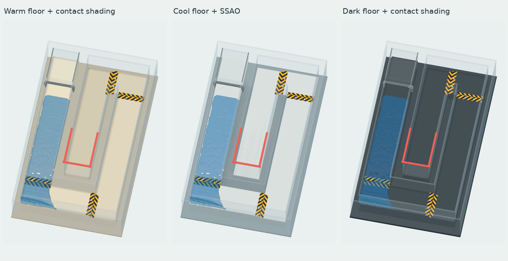
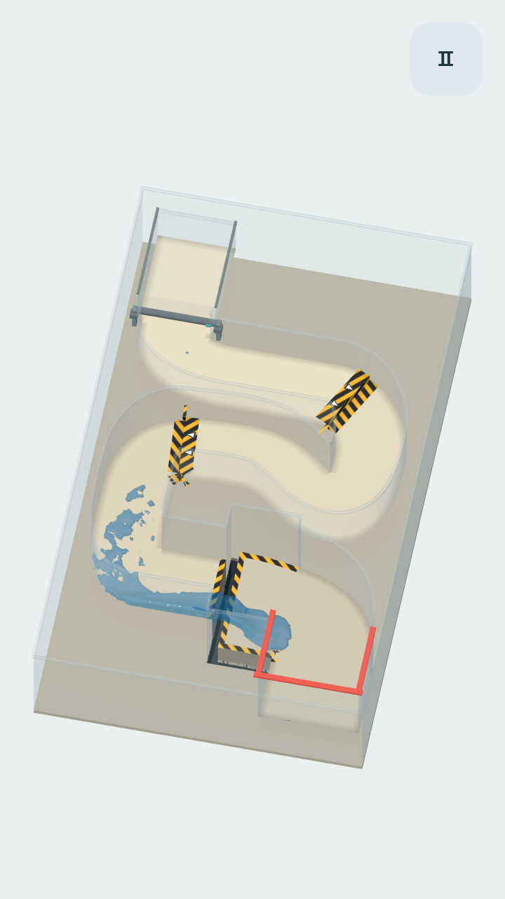

# Читаемость воды и стекла — 0.11.0

Выбран тёплый светлый пол, нейтральное стекло и более насыщенная синяя вода. Объём возвращают направленный свет, поглощение по глубине и мягкое затемнение примыкания стен к полу. Проекционная тень под всем полем не возвращается.

В записи 0.10.0 общий свет сглаживал различие верхних и боковых граней, а вода, стекло и пол были близки по оттенку. Убирать затемнение дальше было бы недостаточно: требовалось разделить материалы цветом и восстановить светотень на самой поверхности.

## Сравнение



Во всех трёх вариантах одинаковы физическое состояние после 150 шагов, геометрия воды, камера, направленный свет и настройки синего материала. Меняются пол и способ контактного затемнения. Измерения выполнены по изображениям одного программного OpenGL-рендера; они помогают сравнить варианты, но не заменяют проверку дисплея телефона.

| Вариант | Среднее расстояние RGB от сухой сцены | Яркость воды | Вывод |
| --- | ---: | ---: | --- |
| Тёплый пол + контактное затемнение | 0.482 | 0.592 | Выбран: вода отделена по цвету, дно и примыкания читаются. |
| Холодный пол + SSAO | 0.465 | 0.592 | Цвет пола остаётся ближе к стеклу; затемнение сильнее подчёркивает непрозрачное основание. |
| Тёмный пол + контактное затемнение | 0.236 | 0.380 | Вода выглядит темнее, отличия от дна слабее. |

Это расстояние в нормированных экранных RGB, а не перцепционная метрика или оценка физической точности материала. Маска состоит из пикселей, изменившихся при включении воды; усредняются отсчёты через два пикселя.

## Что изменено

- Пол — светлый тёплый, с небольшой разницей оттенков между высотами. Подложка темнее пола, чтобы границы стеклянного объёма не растворялись в фоне.
- Стекло — нейтральное, с плавными непрерывными кромками. Прозрачность зависит от угла взгляда; ориентация боковой грани вычисляется в мировых координатах.
- Вода — синее и менее высветленное тело, отражения на гранях, поглощение по локальной глубине. Меньше общего заполняющего света и больше направленного: верх и бока волн получают разную яркость.
- Контактное затемнение — узкая градиентная полоса только вдоль реального примыкания стены к полу. Она принадлежит уровню, сохраняет положение при вращении и не отбрасывает след на фон. В проёме нет ложной тёмной площадки или полосы, изображающей дно.
- Новый уровень использует кривые Безье в изображении и столкновениях. Пол под разрывом удалён, нижний приёмный желоб расширен. Чёрно-жёлтые полосы показывают край, а тёмная глубина — риск потери воды.

## Криволинейный маршрут и перелив



Это кадр нативной симуляции после плавной смены направления перед разрывом. Под струёй нет скрытого пола.

## Воспроизведение и источники

```bash
./scripts/godot.sh --audio-driver Dummy --resolution 720x1600 --script res://scripts/visual_study.gd
```

Кадры `build/study-*.png` и измерения `build/visual-study.json` создаются автоматически. Физика остановлена до сравнения, поэтому её движение не меняет результат между вариантами.

Проверены официальные [возможности рендереров Godot 4.6](https://github.com/godotengine/godot-docs/blob/4.6/tutorials/rendering/renderers.rst) и [режимы пространственного шейдера](https://github.com/godotengine/godot-docs/blob/4.6/tutorials/shaders/shader_reference/spatial_shader.rst). В Godot 4.6 SSAO доступен в Compatibility. Используемое прозрачное стекло имеет `depth_draw_never`; сравнение показало, что контролируемое затемнение примыканий лучше подчёркивает его форму в этой сцене. Проекционные тени отключены отдельно от обычного освещения материалов.

Проверка рендеринга дополнительно сравнивает одну сцену с водой и без неё и требует различимого синего тела на тёплом полу. Невидимый движущийся объект не создаёт тени, а контрольное включение теней позволяет тесту обнаружить её.

FPS, нагрев и читаемость этой версии на физическом Android-устройстве пока не измерены.
