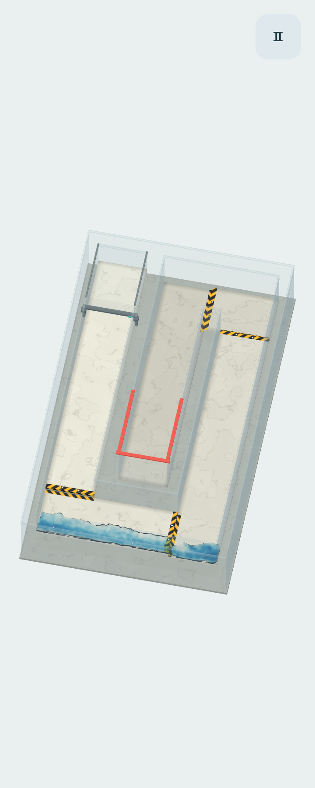

# Вода в версии 0.15.0

Изменения касаются и прежних уровней. Их геометрия, начальный запас воды и параметры вязкости, поверхностного натяжения и гравитации сохранены.

## Движение и объём

У кривой стенки допустимое положение маркера иногда попадает в вычислительную ячейку, центр которой находится внутри стены. Прежде такая вода выпадала из расчёта давления и могла собираться в почти совпадающие точки. Теперь перенос скорости использует ближайшую связанную жидкую ячейку; физическое положение маркера при этом не меняется.

Дополнительное локальное перераспределение включается только при чрезмерном скоплении маркеров. Оно раздвигает совпадающие траектории, не добавляя скорости, массы или постоянных связей. Обычная струя и уже оторвавшиеся брызги сохраняют своё движение. Реакция на тонкие борта учитывает сторону, с которой вода подошла к поверхности: дальняя грань больше не проталкивает её сквозь стену.

При проверке двух закрытых секций после 12 секунд сильных разнонаправленных наклонов сохранены все 1024 маркера и 1024 различных положения; максимум в ячейке размером 0,07 — 25 маркеров. Объём восстановленной сетки — 0,05048 при представленном физическом объёме 0,05619. Это проверка против схлопывания, а не доказательство точности всей гидродинамики.

## Изображение

Вместо постоянного синего покрытия поверхность использует толщину воды вдоль луча камеры. Толщина восстанавливается из физического объёма маркеров: тонкий слой прозрачнее глубокой лужицы. Рисунок дна слегка преломляется, красный свет поглощается быстрее синего, а блик меняется с углом взгляда. Мелкие волны следуют реальной скорости потока и останавливаются при паузе.

Сетка сглаживается с компенсацией усадки, нормали фильтруются отдельно. Изолированная капля получает устойчивую объёмную форму, даже когда её размер меньше шага восстановления поверхности. Её нарисованный объём соответствует объёму одного физического маркера; капли не удаляются ради более гладкого изображения.

Экранное преломление использует непрозрачный фон. Оно не рассчитывает многократное прохождение света через воду и стекло. Разрешение расчётной сетки и поверхности ограничено: мелкие брызги и очень тонкие плёнки остаются приближением.

Проверки: `tests/water_optics.gd`, прежние маршруты в `tests/run.gd`, игровой ввод и настоящий OpenGL в `tests/visual.gd` и `tests/advanced_input.gd`. Итоговые результаты и ограничения сборки — в [VALIDATION.md](VALIDATION.md).
